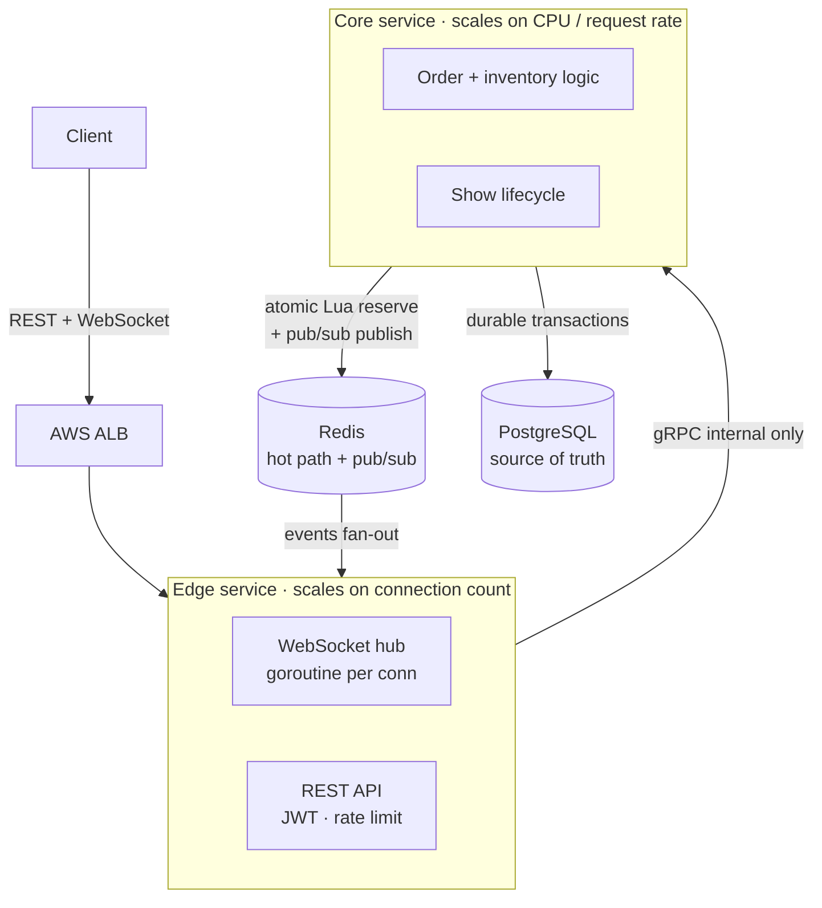

<div align="center">

# LiveDrop

**A real-time live-commerce backend that fans live inventory to thousands of viewers and never oversells under burst load.**

[](https://go.dev/)
[](https://grpc.io/)
[](https://redis.io/)
[](https://www.postgresql.org/)
[](https://www.terraform.io/)

</div>

---

## Table of contents

- [Overview](#overview)
- [The problem](#the-problem)
- [Architecture](#architecture)
- [How it works](#how-it-works)
  - [Real-time fan-out](#real-time-fan-out)
  - [The no-oversell purchase path](#the-no-oversell-purchase-path)
- [Correctness and failure handling](#correctness-and-failure-handling)
- [Tech stack](#tech-stack)
- [Getting started](#getting-started)
- [Configuration](#configuration)
- [API reference](#api-reference)
- [Benchmarks](#benchmarks)
- [Observability](#observability)
- [Deployment](#deployment)
- [Project structure](#project-structure)
---

## Overview

LiveDrop is the backend for a Whatnot-style live shopping experience: a seller goes
live, pushes products to a live audience, and runs flash sales; thousands of viewers
watch the current product, stock, and sold-out events update in real time; and buyers
race to purchase limited stock.

The system is built around a single invariant:

> **No oversell, ever — while thousands of connected viewers see stock change in near
> real time.**

Everything in the design serves that invariant. Video streaming is intentionally out
of scope (delegated to an external provider); LiveDrop is the real-time orchestration
and commerce layer around it.

## The problem

Two hard problems sit at the center of live commerce, and they have opposite shapes:

1. **Real-time fan-out at scale.** A single state change (a product goes on stage,
   stock ticks down) must reach thousands of concurrently connected viewers within
   tens of milliseconds, across horizontally scaled server instances.

2. **Correctness under contention.** When a flash sale opens, thousands of buyers may
   click *Buy* in the same instant against a handful of units. The system must resolve
   that race so that stock is never sold twice — regardless of how many server
   instances are handling the requests.

The first is a broadcast problem (one writer, many readers, low latency). The second
is a concurrency-correctness problem (many writers, one contested resource). LiveDrop
solves them with two services that scale independently, an atomic reservation on the
hot path, and Redis Pub/Sub for fan-out.

## Architecture

LiveDrop is split into **two services** — not a monolith, and not a sprawl of
microservices. The split exists for one concrete reason: the two halves of the
workload have fundamentally different resource profiles.



| Property         | Edge service                    | Core service                     |
|------------------|---------------------------------|----------------------------------|
| Primary resource | Memory (open sockets)           | CPU + DB connections             |
| Scales with      | Viewer count (10K+)             | Purchase rate                    |
| Public surface   | Yes (REST + WebSocket)          | No (internal gRPC only)          |
| Autoscaling on   | Active WebSocket connections    | CPU utilization                  |

Because the two services scale on different signals and fail with different blast
radius, they are deployed and autoscaled independently. This is also why **gRPC** is a
real, load-bearing choice here: it is the type-safe contract across a genuine process
boundary, not an in-process call. The core service has no public surface at all — it
is unreachable from the internet.

**Roles at a glance:**

- **Edge** — holds all WebSocket connections, terminates the public REST API, verifies
  JWTs and rate limits, subscribes to Redis Pub/Sub, and fans events to local
  connections. Never touches Postgres.
- **Core** — owns the show lifecycle, the inventory reservation path, orders,
  idempotency, and all Postgres transactions. Publishes state changes to Redis.

## How it works

### Real-time fan-out

Each WebSocket connection is served by a lightweight goroutine pair (`readPump` /
`writePump`) and registered into an in-memory room keyed by show ID. A state change on
**any** core instance becomes a single Redis publish; Redis delivers it to **every**
edge instance subscribed to that show; each edge instance broadcasts to only its local
connections.

This decouples core from the number of edge instances — core publishes **once**
regardless of whether there is 1 edge instance or 50. That is precisely why Redis
Pub/Sub is used for fan-out instead of core streaming to each instance directly (which
would make core a fan-out bottleneck).

```
core (any instance) ──publish──▶ Redis channel show:{id}:events
                                      │
              ┌───────────────────────┼───────────────────────┐
              ▼                       ▼                        ▼
        edge instance 1        edge instance 2          edge instance N
        broadcast to local     broadcast to local       broadcast to local
        WebSocket rooms        WebSocket rooms           WebSocket rooms
```

### The no-oversell purchase path

The purchase path is fully synchronous and never touches WebSockets. The oversell
invariant is guaranteed by a **single atomic Redis Lua script** — nothing else is
allowed to decrement stock.

```
buyer ──▶ Edge (JWT + rate limit) ──gRPC──▶ Core
                                              │
                              1. reserve ─────┼───▶ Redis  (atomic Lua DECRBY, gated on stock)
                                              │
                              2. commit ──────┼───▶ Postgres (order + sold_count + idempotency, one tx)
                                              │
                              3. publish ─────┼───▶ Redis  (INVENTORY_UPDATE → fan-out to viewers)
                                              ▼
                                  (on tx failure: release reservation)
```

1. **Reserve (Redis, atomic).** A Lua script checks remaining stock and decrements it
   in a single atomic operation. If 5,000 buyers hit *Buy* in the same second, only as
   many succeed as there is stock. This is the single point that prevents oversell.

   ```lua
   -- KEYS[1] = product:{id}:stock, ARGV[1] = quantity
   local stock = tonumber(redis.call('GET', KEYS[1]))
   if stock == nil then return -1 end               -- not seeded → caller rehydrates
   if stock >= tonumber(ARGV[1]) then
       return redis.call('DECRBY', KEYS[1], ARGV[1]) -- returns remaining
   end
   return -2                                         -- sold out
   ```

2. **Commit (Postgres, transactional).** In one transaction: insert the idempotency key
   (`ON CONFLICT DO NOTHING` — a duplicate request replays the stored response instead
   of decrementing again), insert the order, and increment `sold_count`.

3. **Publish (Redis).** On success, publish `INVENTORY_UPDATE` (and `SOLD_OUT` if
   remaining hit zero) so every viewer sees stock change in near real time.

If the Postgres commit fails, the Redis reservation is **released** (`INCRBY`) so the
count is never permanently lost.

## Correctness and failure handling

| Concern                        | Mechanism                                                                 |
|--------------------------------|---------------------------------------------------------------------------|
| **Oversell**                   | Single atomic Lua `DECRBY` gated on stock; the *only* path that decrements |
| **Duplicate orders / retries** | Idempotency key with `INSERT ... ON CONFLICT DO NOTHING` (insert-and-catch, race-safe) |
| **Redis restart / eviction**   | Stock rehydrated from Postgres as `total_stock - sold_count` on cache miss |
| **Failed DB commit**           | Redis reservation released so stock is not lost                           |
| **Orphaned reservation**       | Reconciliation compares Redis stock vs Postgres for active products       |
| **Slow WebSocket client**      | Bounded send buffer; slow client dropped rather than blocking the room    |
| **Sale window expiry**         | Server validates `ends_at` on every order, independent of client state    |

The recurring principle: **Redis is authoritative on the hot path for speed;
PostgreSQL is the durable source of truth.** The cache can be lost and rebuilt without
compromising correctness.

## Tech stack

| Layer            | Technology                                   |
|------------------|----------------------------------------------|
| Language         | Go 1.22                                       |
| Internal RPC     | gRPC (edge ↔ core)                            |
| Public API       | REST + WebSocket                              |
| Hot path / cache | Redis (atomic Lua, Pub/Sub, rate limiting)   |
| Source of truth  | PostgreSQL                                    |
| Orchestration    | Kubernetes (AWS EKS)                          |
| Infrastructure   | Terraform (EKS, RDS, ElastiCache, ALB)       |
| CI/CD            | GitHub Actions → ECR → EKS                    |
| Observability    | Prometheus + structured logging              |

## Getting started

### Prerequisites

- Go 1.22+
- Docker and Docker Compose
- `protoc` with the Go plugins (only if you regenerate gRPC stubs)
- `make`

### Run locally

The full stack (edge, core, Postgres, Redis) runs with Docker Compose:

```bash
git clone https://github.com/<you>/livedrop.git
cd livedrop

cp .env.example .env        # adjust values if needed
make up                     # docker compose up --build
make migrate                # apply Postgres schema
```

Services start on:

| Service  | Address                  |
|----------|--------------------------|
| Edge     | `http://localhost:8080`  |
| Core     | `localhost:9090` (gRPC)  |
| Postgres | `localhost:5432`         |
| Redis    | `localhost:6379`         |

Tear down with `make down`.

### Common make targets

```bash
make up         # build and start the full stack
make down       # stop and remove containers
make migrate    # apply database migrations
make proto      # regenerate gRPC stubs from proto/
make test       # run unit and integration tests
make loadtest   # run the k6 load-test suite (see Benchmarks)
```

## Configuration

Configuration is via environment variables (see `.env.example`):

| Variable            | Description                              | Default                  |
|---------------------|------------------------------------------|--------------------------|
| `EDGE_HTTP_ADDR`    | Edge REST + WebSocket listen address     | `:8080`                  |
| `CORE_GRPC_ADDR`    | Core gRPC listen address                 | `:9090`                  |
| `DATABASE_URL`      | PostgreSQL connection string             | —                        |
| `REDIS_ADDR`        | Redis address                            | `localhost:6379`         |
| `JWT_SECRET`        | Secret for verifying access tokens       | —                        |
| `RATE_LIMIT_RPS`    | Per-user request rate limit              | `10`                     |
| `RESERVE_TTL`       | Reservation lease TTL (seconds)          | `30`                     |

## API reference

### REST (public, via edge)

| Method | Endpoint                          | Auth   | Description                    |
|--------|-----------------------------------|--------|--------------------------------|
| `POST` | `/v1/shows`                       | seller | Create a show                  |
| `POST` | `/v1/shows/{id}/products`         | seller | Add a product with stock       |
| `POST` | `/v1/shows/{id}/go-live`          | seller | Transition a show to live      |
| `POST` | `/v1/shows/{id}/push-product`     | seller | Stage a product                |
| `POST` | `/v1/shows/{id}/start-sale`       | seller | Open a sale window             |
| `POST` | `/v1/products/{id}/orders`        | buyer  | Buy (requires `Idempotency-Key`) |
| `GET`  | `/v1/shows/{id}`                  | any    | Show snapshot                  |
| `GET`  | `/v1/ws/shows/{id}?token=JWT`     | any    | Upgrade to WebSocket           |

**Buy request**

```http
POST /v1/products/{id}/orders
Authorization: Bearer <JWT>
Idempotency-Key: 4b9c...e1
Content-Type: application/json

{ "quantity": 1 }
```

**Responses:** `201 Created` (confirmed), `409 Conflict` (sold out),
`200 OK` (duplicate — original result replayed), `429 Too Many Requests` (rate limited).

### WebSocket events

Clients receive JSON event frames on `/v1/ws/shows/{id}`:

```json
{ "type": "PRODUCT_PUSHED",   "product": { "id": "...", "title": "...", "stock": 10, "price_cents": 10000 } }
{ "type": "SALE_STARTED",     "product_id": "...", "sale_type": "FLASH", "ends_at": "2026-01-01T10:00:30Z" }
{ "type": "INVENTORY_UPDATE", "product_id": "...", "stock": 9 }
{ "type": "SOLD_OUT",         "product_id": "..." }
{ "type": "VIEWER_COUNT",     "count": 8421 }
```

### gRPC (internal, edge ↔ core)

Defined in [`proto/commerce.proto`](proto/commerce.proto):

```protobuf
service CommerceService {
  rpc GoLive          (GoLiveReq)      returns (ShowState);
  rpc PushProduct     (PushProductReq) returns (ShowState);
  rpc StartSale       (StartSaleReq)   returns (SaleState);
  rpc PlaceOrder      (PlaceOrderReq)  returns (PlaceOrderResp);
  rpc GetShowSnapshot (SnapshotReq)    returns (ShowSnapshot);
}
```

## Benchmarks

Load tests are run with [k6](https://k6.io/) against the containerized stack. The
scripts live in [`scripts/loadtest/`](scripts/loadtest/) and are reproducible via
`make loadtest`.

**Purchase-contention test** — N concurrent buyers race for limited stock; the pass
condition is that confirmed orders exactly equal available stock (zero oversell).

**Fan-out test** — N concurrent WebSocket clients subscribe to a show; a state change
is published and end-to-end delivery latency is measured.

| Scenario                         | Result                                   |
|----------------------------------|------------------------------------------|
| Concurrent WebSocket connections | 10,000+ sustained                        |
| Event delivery latency (P99)     | < 80 ms                                  |
| Oversell under burst             | 0 (confirmed orders == available stock)  |
| Duplicate orders under retry     | 0                                        |

> **Reproducing:** `make loadtest`. Environment (instance sizes, node count, and the
> exact k6 config) is documented in [`scripts/loadtest/README.md`](scripts/loadtest/).

## Observability

- **Metrics (Prometheus):** `oversell_attempts_total` (reservation attempts that hit
  zero stock — proves the invariant holds under load), `websocket_active_connections`
  (also drives edge autoscaling), `inventory_reserve_latency_seconds`,
  `orders_total{result=...}`.
- **Structured logs:** JSON, keyed by `show_id`, `product_id`, `buyer_id`, and a
  request ID propagated edge → core.

## Deployment

Infrastructure is provisioned with **Terraform** and the services run on **AWS EKS**.

- **Terraform** ([`deploy/terraform/`](deploy/terraform/)) provisions the VPC, EKS
  cluster, RDS PostgreSQL, ElastiCache Redis, and the ALB.
- **Kubernetes** ([`deploy/k8s/`](deploy/k8s/)) defines two Deployments, each with its
  own HPA — **edge autoscales on WebSocket connection count, core on CPU** — plus a
  NetworkPolicy restricting core's gRPC port to edge traffic only.
- **CI/CD:** GitHub Actions builds and tests on push, pushes images to ECR, and
  deploys to EKS.

```
Terraform ──▶ VPC · EKS · RDS · ElastiCache · ALB
GitHub Actions ──▶ build + test ──▶ ECR ──▶ EKS
```

## Project structure

```
/cmd
  /edge/main.go            # REST + WebSocket server, gRPC client to core
  /core/main.go            # gRPC server, Redis + Postgres clients
/internal
  /edge
    /api                   # REST handlers, JWT middleware, rate limiting
    /realtime              # hub, rooms, read/write pumps, pub/sub subscriber
  /core
    /show                  # lifecycle state machine
    /inventory             # Lua reservation, rehydration, reconciliation
    /order                 # PlaceOrder, idempotency, Postgres transactions
  /store
    /postgres              # queries, migrations
    /redis                 # client, Lua scripts, keyspace helpers
/proto                     # commerce.proto
/deploy
  /terraform               # vpc, eks, rds, elasticache, alb
  /k8s                     # edge + core deployments, services, HPA, netpol
/scripts/loadtest          # k6 scripts + methodology
```
